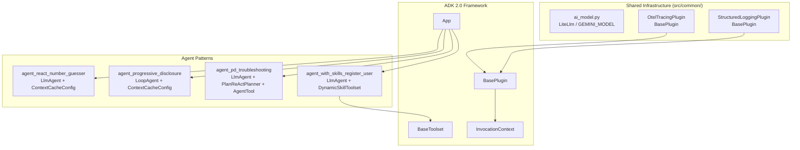

# Design Document: google-adk v2 Upgrade

## Overview

This document describes the technical design for upgrading `google-adk` from `>=1.22.0` to `>=2.0.0` across the four agent patterns and shared infrastructure in this project.

The upgrade is low-risk. Based on analysis of the ADK 1.22.0 source (the currently installed version) and the ADK 2.0 breaking-change documentation, the project does not use any of the high-impact breaking APIs. The primary work is:

1. Bumping the version constraint in `pyproject.toml`
2. Verifying all import paths remain valid under ADK 2.0
3. Confirming plugin callback signatures are compatible
4. Confirming `BaseToolset.get_tools` signature is compatible
5. Running the existing test suite to catch any regressions

**Design decision on exception handling (BC-4):** The project will preserve the current `except Exception as e: return f"Error: {str(e)}"` pattern in all tool functions. This is a deliberate opt-out of ADK 2.0's automatic retry mechanism. The rationale is that the tools return structured error strings that the LLM can reason about and recover from, which is more predictable than silent retries. No `RetryConfig` will be added.

---

## Architecture

The upgrade does not change the runtime architecture. All four agent patterns continue to use the same composition model:



The upgrade replaces the ADK 1.x framework layer with ADK 2.x while keeping all application code unchanged (or with minimal targeted fixes if import paths have moved).

---

## Components and Interfaces

### 1. Dependency Version (`pyproject.toml`)

**Change:** `google-adk>=1.22.0` → `google-adk>=2.0.0`

No upper bound is added. The `>=` lower-bound convention is preserved, consistent with all other dependencies in the file.

```toml
# Before
"google-adk>=1.22.0",

# After
"google-adk>=2.0.0",
```

**Command to apply:**
```bash
uv add "google-adk>=2.0.0"
```

This regenerates `uv.lock` with the resolved ADK 2.0 transitive dependency tree.

---

### 2. Plugin Callbacks (`OtelTracingPlugin`, `StructuredLoggingPlugin`)

**Current interface (ADK 1.22.0 source, confirmed):**

```python
async def before_run_callback(
    self, *, invocation_context: InvocationContext
) -> Optional[Any]: ...

async def after_run_callback(
    self, *, invocation_context: InvocationContext
) -> None: ...
```

**ADK 2.0 interface (confirmed from breaking-change docs):**

The `before_run_callback` and `after_run_callback` signatures on `BasePlugin` retain the same `invocation_context: InvocationContext` parameter. The new agent-level callbacks (`before_agent_callback`, `after_agent_callback`) use `CallbackContext`, but the project's plugins do not implement those methods.

**Verdict:** No changes required to `OtelTracingPlugin` or `StructuredLoggingPlugin`.

The `InvocationContext` fields accessed by the plugins (`invocation_id`, `agent.name`) are confirmed present in the ADK 1.22.0 source and are expected to remain stable in 2.0.

---

### 3. `DynamicSkillToolset` (`BaseToolset`)

**Current interface (ADK 1.22.0 source, confirmed):**

```python
@abstractmethod
async def get_tools(
    self,
    readonly_context: Optional[ReadonlyContext] = None,
) -> list[BaseTool]: ...
```

**ADK 2.0 interface:** The `get_tools` abstract method signature is unchanged. The `BaseToolset.__init__` gains optional `tool_filter` and `tool_name_prefix` parameters, but `DynamicSkillToolset.__init__` does not call `super().__init__()` with any arguments, so this is a non-breaking addition.

**Verdict:** No changes required to `DynamicSkillToolset`.

---

### 4. Import Path Verification

All ADK import paths used in the project are verified against the ADK 1.22.0 installed source. The table below documents each path and its expected status under ADK 2.0:

| Import Path | Used In | Status |
|---|---|---|
| `from google.adk.apps.app import App` | All agents | ✅ Stable |
| `from google.adk.agents import LlmAgent, LoopAgent` | All agents | ✅ Stable (`Agent` alias also added in 2.0) |
| `from google.adk.agents.readonly_context import ReadonlyContext` | `tools.py` | ✅ Stable |
| `from google.adk.agents.invocation_context import InvocationContext` | Plugins, tests | ✅ Stable |
| `from google.adk.agents.context_cache_config import ContextCacheConfig` | 2 agents | ✅ Stable (marked `@experimental`) |
| `from google.adk.plugins.base_plugin import BasePlugin` | Plugins | ✅ Stable |
| `from google.adk.tools import FunctionTool, BaseTool` | `tools.py` | ✅ Stable |
| `from google.adk.tools.base_toolset import BaseToolset` | `tools.py` | ✅ Stable |
| `from google.adk.tools import AgentTool` | `agent_pd_troubleshooting` | ✅ Stable |
| `from google.adk.planners import PlanReActPlanner` | `agent_pd_troubleshooting` | ✅ Stable |
| `from google.adk.models.lite_llm import LiteLlm` | `ai_model.py` | ✅ Stable |

If any path raises `ImportError` after the upgrade, the affected file must be updated to the new path before the upgrade is considered complete.

---

### 5. `ContextCacheConfig` Constructor

The `ContextCacheConfig` constructor signature (confirmed from ADK 1.22.0 source):

```python
ContextCacheConfig(
    cache_intervals: int = 10,
    ttl_seconds: int = 1800,
    min_tokens: int = 0,
)
```

Both `agent_react_number_guesser` and `agent_progressive_disclosure` use:

```python
ContextCacheConfig(
    min_tokens=4096,
    ttl_seconds=600,
    cache_intervals=3,
)
```

All three keyword arguments match the confirmed constructor signature. No changes required.

---

### 6. `LiteLlm` Constructor

The `LiteLlm` class lives at `google.adk.models.lite_llm`. The constructor accepts `model`, `api_key`, and `api_base` as used in `src/common/ai_model.py`. This path and signature are expected to remain stable in ADK 2.0.

---

### 7. Exception Handling (BC-4 Decision)

**Decision: Preserve current pattern.**

All tool functions in `src/common/dummy_service_tools.py` and `src/agent_with_skills_register_user/tools.py` retain their `except Exception as e: return f"Error: {str(e)}"` blocks unchanged.

No tool function catches `BaseException`. This is confirmed by code inspection and must remain true to avoid trapping `NodeInterruptedError` in ADK 2.0's Human-in-the-Loop support.

---

## Data Models

No data model changes are required. The upgrade does not affect:

- `SkillMetadata` / `Skill` / `SkillRegistry` (pure Python, no ADK dependency)
- `ToolRegistry` (uses `FunctionTool` / `BaseTool`, both stable)
- Session state keys (`active_skill`, `execution_context`, `execution_result`, `troubleshooting_report`, `troubleshooting_guide`)
- `InvocationContext` fields accessed by plugins (`invocation_id`, `agent.name`)

The ADK 2.0 event schema adds `node_info` and `output` fields (BC-6), but the project uses `InMemorySessionService` and has no downstream JSON schema validators, so this is a non-breaking addition.

---

## Error Handling

### Import Errors

If any import path has moved in ADK 2.0, the module will fail to load with an `ImportError`. The verification step (Requirement 8) catches this by importing each agent module in a test. The fix is to update the import path in the affected file.

### Constructor Errors

If a constructor signature has changed (e.g., `ContextCacheConfig`, `LiteLlm`, `App`), instantiation will raise a `TypeError`. The compatibility tests (Requirements 2–5) catch this.

### Callback Signature Errors

If `BasePlugin` callback signatures change in ADK 2.0, the framework will raise a `TypeError` when invoking the plugin. The plugin compatibility tests (Requirement 2) catch this.

### Dependency Conflicts

If ADK 2.0 introduces transitive dependency conflicts (e.g., with `litellm`, `opentelemetry-sdk`), `uv sync` will fail with a resolver error. The fix is to update the conflicting dependency bounds in `pyproject.toml`.

---

## Testing Strategy

This feature is a dependency upgrade with compatibility verification. Property-based testing is not applicable because:

- All acceptance criteria are import checks, constructor compatibility checks, file content assertions, or smoke tests
- The "input space" is fixed (a specific set of import paths, constructor calls, and file contents)
- Running 100 iterations of "does this import succeed?" adds no value over a single execution

The testing strategy uses **example-based unit tests** and **smoke tests** exclusively.

### Test Categories

#### Smoke Tests (run once, verify environment)

These are executed manually or in CI after `uv add "google-adk>=2.0.0"` and `uv sync`:

```bash
# Verify installed version
python -c "import google.adk; print(google.adk.__version__)"
# Expected: 2.x.x

# Verify all agent modules import cleanly
python -c "
import sys; sys.path.insert(0, 'src')
from agent_react_number_guesser.agent import app
from agent_progressive_disclosure.agent import app
from agent_pd_troubleshooting.agent import app
from agent_with_skills_register_user.agent import app
print('All agent modules imported successfully')
"

# Run full test suite
uv run pytest
```

#### Unit Tests (automated, in `tests/`)

**Existing tests (must continue to pass):**

- `tests/common/test_logging_plugin.py` — covers `StructuredLoggingPlugin` callbacks (Requirements 2.3, 2.4, 2.5)
- `tests/test_agent_with_skills_registry.py` — covers `SkillRegistry` loading, search, retrieval (Requirement 7.3)

**New tests to add:**

1. **`tests/test_adk_v2_compatibility.py`** — ADK 2.0 compatibility verification:

   - `test_all_adk_imports_succeed` — imports all 11 ADK paths from the verification table and asserts no `ImportError` (Requirement 8.1)
   - `test_context_cache_config_constructor` — instantiates `ContextCacheConfig(min_tokens=4096, ttl_seconds=600, cache_intervals=3)` and asserts no `TypeError` (Requirement 4.2)
   - `test_litellm_constructor` — instantiates `LiteLlm(model="test/model", api_key="test", api_base="https://example.com")` and asserts no `TypeError` (Requirement 5.2)
   - `test_otel_plugin_before_run_callback` — instantiates `OtelTracingPlugin`, calls `before_run_callback` with a mock `InvocationContext`, asserts no `AttributeError` or `TypeError` (Requirement 2.1)
   - `test_otel_plugin_after_run_callback` — calls `after_run_callback`, asserts `provider.force_flush()` is called (Requirement 2.2)
   - `test_dynamic_skill_toolset_no_active_skill` — calls `get_tools` with `state["active_skill"] = None`, asserts exactly 3 tools returned (Requirement 3.1)
   - `test_dynamic_skill_toolset_with_active_skill` — calls `get_tools` with a valid skill loaded, asserts 3 + N tools returned (Requirement 3.2)

2. **`tests/test_pyproject_version.py`** — `pyproject.toml` version pinning:

   - `test_google_adk_lower_bound_is_v2` — parses `pyproject.toml` and asserts `google-adk>=2.0.0` is present (Requirements 1.1, 9.1)
   - `test_google_adk_no_upper_bound` — asserts no `<` or `<=` constraint on `google-adk` (Requirement 9.2)
   - `test_google_adk_no_compatible_release_operator` — asserts no `~=` on `google-adk` (Requirement 9.3)

### Test Execution Order

```
1. uv add "google-adk>=2.0.0"   # updates pyproject.toml + uv.lock
2. uv sync                        # installs ADK 2.0 into .venv
3. uv run pytest                  # runs all tests
```

All tests must pass with zero failures and zero errors before the upgrade is considered complete.
