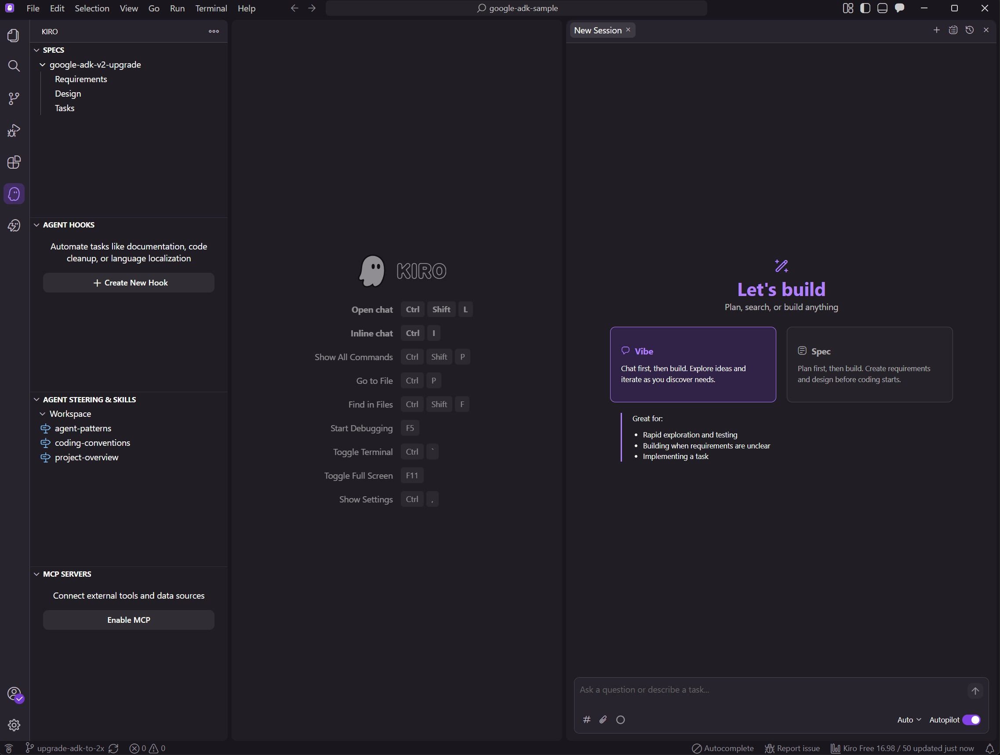
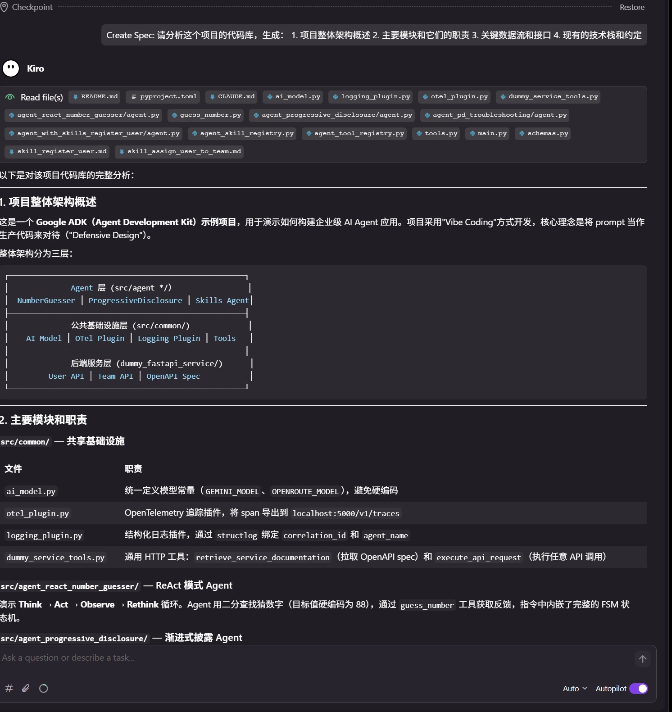
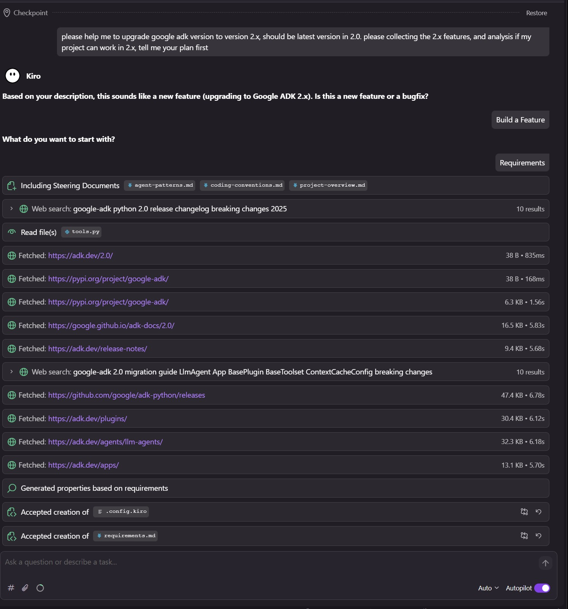

# AWS Kiro IDE: Feature Overview & SDD Hands-On Experience

> 📅 Updated: 2026-05  
> 👤 Audience: Developers  
> 🔗 Official site: [kiro.dev](https://kiro.dev)

---

## Table of Contents

- [What is Kiro](#what-is-kiro)
- [Core Features](#core-features)
  - [Specs — The Three-File System](#specs--the-three-file-system)
  - [Steering Files — Persistent Context](#steering-files--persistent-context)
  - [Agent Hooks — Automated Quality Gates](#agent-hooks--automated-quality-gates)
  - [Skills — Reusable Knowledge Packages](#skills--reusable-knowledge-packages)
  - [Powers — Dynamic Tool Loading](#powers--dynamic-tool-loading)
- [SDD Workflow in Practice](#sdd-workflow-in-practice)
  - [New Projects](#new-projects)
  - [Existing Projects](#existing-projects)
- [Pricing](#pricing)
- [Personal Experience & Recommendations](#personal-experience--recommendations)
  - [Hands-On with google-adk-sample](#hands-on-with-google-adk-sample)
  - [What Works Well](#what-works-well)
  - [Things to Watch Out For](#things-to-watch-out-for)
- [Open-Source Status & Known Limitations](#open-source-status--known-limitations)
- [References](#references)

---

## What is Kiro

Kiro is an AI-native IDE launched by AWS in 2025, built on the VS Code open-source kernel and powered by Claude models on Amazon Bedrock.

Its core philosophy is **Spec-Driven Development (SDD)** — developers first define clear specifications (Specs), then AI Agents generate and maintain code based on those specs. This fundamentally solves the problem of "AI writes fast but in the wrong direction, leaving a mess to clean up."

In short: **you define what's correct, AI executes correctly.**



---

## Core Features

### Specs — The Three-File System

Specs are Kiro's most central design, structuring each feature's development into three Markdown files stored under `.kiro/specs/`:

| File | Responsibility | Key Question |
|------|---------------|--------------|
| `requirements.md` | What to build — user stories + acceptance criteria | What does this feature mean for the user? |
| `design.md` | How to design it — architecture, data model, interfaces | How to implement it technically? |
| `tasks.md` | How to break it down — Agent execution checklist | Which files to change, what to do? |

**Workflow:**

```
Enter requirement description
    ↓
Kiro generates requirements.md draft
    ↓
✋ Human review (most important intervention point)
    ↓
Kiro generates design.md
    ↓
✋ Human confirms technical approach
    ↓
Generate tasks.md → Agent implements step by step
    ↓
Requirement change → update Spec first, then code
```

`requirements.md` uses the **EARS format** (Easy Approach to Requirements Syntax) for writing user stories — a structured requirements notation developed by Rolls-Royce engineers that effectively eliminates requirement ambiguity.

**Key value:** Requirement changes have a complete audit trail; you always know "why this was changed."

---

### Steering Files — Persistent Context

Steering files live under `.kiro/steering/` and should be committed to Git for team sharing. They are automatically loaded every session, ensuring the AI always follows project conventions without re-explaining context each time.

**Real example (from the google-adk-sample project, three files):**

**`.kiro/steering/project-overview.md`** — project layout, startup commands, service ports:

```markdown
# Project Overview

This is a **Google ADK (Agent Development Kit) sample project** demonstrating
how to build enterprise-grade AI agent applications.

## Repository Layout
google-adk-sample/
├── src/
│   ├── common/                          # Shared infrastructure (models, plugins, tools)
│   ├── agent_react_number_guesser/      # ReAct pattern demo
│   ├── agent_progressive_disclosure/    # Planner+Executor loop demo
│   ├── agent_pd_troubleshooting/        # PlanReActPlanner + AgentTool demo
│   └── agent_with_skills_register_user/ # Dynamic skills (Claude-style) demo
├── dummy_fastapi_service/               # Companion REST backend (port 6060)
└── docker-compose/                      # Local observability stack

## Service Endpoints
| Service        | Port | Purpose                            |
|----------------|------|------------------------------------|
| ADK Web UI     | 8000 | Interactive agent chat interface   |
| FastAPI backend| 6060 | REST API used by agents            |
| OTLP collector | 5000 | OpenTelemetry trace receiver       |

## Resolving Unknown Library Usage
If you are unsure how to use an imported library or an internal ADK class, **do not guess**.
Locate the library source in the virtual environment:
  - `.venv/lib/python3.12/site-packages/<package_name>/`
Read the relevant source files before writing or suggesting code.
This applies especially to google-adk internals (BasePlugin, BaseToolset,
InvocationContext, ReadonlyContext, ToolContext).
```

**`.kiro/steering/coding-conventions.md`** — prompt structure, tool conventions, testing policy (key excerpts):

```markdown
# Coding Conventions

## Agent Instruction (Prompt) Structure
Every agent `instruction` string **must** follow the 4-layer pattern:
# [0] META-LAYER     — Identity, scope rejection, prompt-injection defense
# [1] OBSERVABILITY  — Mandatory <thought_process> XML before every action
# [2] FSM LOGIC      — Explicit state machine: Trigger → State → Action → Transition
# [3] TOOL CONTRACTS — Pre/post-conditions for each tool, semantic-logic mapping

## Prompt Variable Syntax
| Syntax  | Use                                    | Source               |
|---------|----------------------------------------|----------------------|
| `{var?}`| Runtime injection from Python (null-safe) | External environment |
| `<var>` | LLM-internal chain-of-thought variables | Model inference only |
**Never** use bare `{}` for LLM-internal variables — causes Python string formatting errors.

## HTTP Clients
- Use `httpx.AsyncClient` for async tool functions
- Always call `response.raise_for_status()` and wrap in `try/except` returning an error string

## Testing Policy
- Unit tests are **mandatory** for all Python tool functions and plugin classes
- Tests for agent definitions (LlmAgent, App) are **not required**
```

**`.kiro/steering/agent-patterns.md`** — decision tree for the four Agent patterns (excerpt):

```markdown
# Agent Development Patterns

## Choosing a Pattern
Is the task a single iterative loop with one tool?
  └─ YES → Pattern 1: ReAct

Does the task require multiple sequential API calls with validation between steps?
  └─ YES → Pattern 2: Progressive Disclosure (LoopAgent)

Does the task require strategic planning with isolated, safe execution?
  └─ YES → Pattern 3: PlanReActPlanner + AgentTool

Does the agent need to handle many different task domains dynamically?
  └─ YES → Pattern 4: Dynamic Skills
```

The `inclusion` field controls when files are loaded: `always` (every session), `fileMatch` (by file type), `manual` (on demand). All three files above use `always`, ensuring complete context on every session.

**Core value:** Makes tacit team knowledge explicit — both new team members and the AI can align quickly.

---

### Agent Hooks — Automated Quality Gates

Hooks are automated Agent actions triggered by file events. They embed quality checks into the development process itself rather than catching problems at CI.

**Common use cases:**

| Trigger | Purpose |
|---------|---------|
| File save | Automatically check for architecture constraint violations |
| New file created | Auto-generate the corresponding test file |
| After a Task completes | Run the test suite; stop and report on failure |
| Manual trigger | Generate API docs, run a code review |

Hooks are created using natural language descriptions, for example:

> "After every file the Agent modifies, run `pytest`. If tests fail, stop and report the specific errors — do not continue to the next task."

**Core value:** Shifts from "fix it later" to "built-in quality." Even the Agent cannot skip the checks.

---

### Skills — Reusable Knowledge Packages

Skills are portable knowledge packages following the [agentskills.io](https://agentskills.io) open standard, used to inject specialized knowledge into an Agent and activated on demand.

**Difference from Steering:**

| | Steering | Skill |
|--|----------|-------|
| Loading | Auto-loaded every session | Activated on demand |
| Content type | Project constraints and conventions | Step-by-step workflow instructions |
| Scope | Always active | Active when task-relevant |
| Typical example | Tech stack constraints, prohibited actions | Code review process, API design standards |

**Directory structure:**

```
.kiro/skills/
└── api-design/
    ├── SKILL.md        # Required: main instruction file
    ├── references/     # Optional: deep reference documents
    └── scripts/        # Optional: executable scripts
```

**Activation:** Type `/api-design` in the chat box to trigger manually, or Kiro auto-identifies based on context.

**Cross-tool compatibility:** The same Skill works in Kiro, Claude Code, Cursor, Gemini CLI, and 40+ other tools. Write once, use everywhere.

---

### Powers — Dynamic Tool Loading

Powers is Kiro's dynamic MCP tool loading mechanism. Traditional approaches load all integration tools at once, consuming large amounts of the context window. Powers activates them on demand:

- Mention "payment" → Stripe Power activates automatically
- Switch to database work → Supabase Power activates, Stripe unloads

**Supported ecosystem partners:** Datadog, Figma, Neon, Netlify, Postman, Supabase, Stripe, and more.

---

## SDD Workflow in Practice

### New Projects

```
Step 1: Establish Steering files
        Tech stack + architecture conventions + prohibited actions
             ↓
Step 2: Create the first Spec
        Requirement description → requirements.md → human confirmation
             ↓
Step 3: Confirm design.md
        Key check: does the approach fit the architecture? Any unnecessary dependencies?
             ↓
Step 4: Execute tasks.md
        Agent implements task by task; enable Supervised mode for file-by-file review
             ↓
Step 5: Configure Hooks
        Check conventions on save, run tests on completion
```

**Supervised mode:** When the Agent modifies multiple files, you can review file by file and selectively accept or reject each change. Recommended for new projects early on; loosen up once you're familiar with Kiro's behavior.

---

### Existing Projects

For existing codebases, Kiro provides two specialized Spec types to avoid unnecessary friction from the full three-file flow.

**Design-First Spec** — when you already have a clear technical approach

Write `design.md` first (you already know how to do it), then let Kiro reverse-engineer `requirements.md`. Suitable for adding features within an existing architecture without breaking existing conventions.

**Bugfix Spec** — surgical fixes

Structured into three parts:

```
Current Behavior:
  "When a user submits a form with special characters, the system crashes with 500"

Expected Behavior:
  "Should sanitize input and process normally, returning 200"

Unchanged Behavior: ← most important
  "The processing flow for valid forms must remain unchanged"
```

The "Unchanged Behavior" field is critical — it explicitly tells the Agent what must not change, preventing the fix from introducing new problems.

**Brownfield cold-start recommendations:**
1. Let Kiro analyze the codebase and generate a project overview document
2. Refine the analysis into Steering files (a one-time investment worth the time)
3. Start with low-risk new features — don't use core modules as your first experiment
4. Establish a team norm of "changes must include a Spec" to gradually increase Spec coverage

---

## Pricing

| Plan | Price | Agentic Interactions |
|------|-------|---------------------|
| Free | Free | 50/month |
| Pro | $19/month | 1,000/month |
| Pro+ | $39/month | 3,000/month |
| Overage | $0.04/interaction | Pay-as-you-go |

> 💡 One "Agentic interaction" may be a complex task running 3–5 minutes across multiple files — it is not equivalent to a single chat message. The 50 free interactions are sufficient for a thorough evaluation.

---

## Personal Experience & Recommendations

> **Overall verdict: I do not recommend adopting Kiro for production teams.**  
> Two core reasons: first, Kiro is closed-source software — you cannot audit or modify its behavior; second, and more critically — the internal prompt logic that generates `requirements.md`, `design.md`, and `tasks.md` is completely opaque. You cannot swap the LLM, and you cannot modify the Spec generation configuration. This means you are handing the most critical engineering decisions (how requirements are broken down, how solutions are designed, how tasks are organized) to a black box that is neither transparent nor customizable. The value of SDD lies in making your process controllable — but Kiro's closed design puts precisely that key step out of your control.

### Hands-On with google-adk-sample

This section documents a concrete experience using Kiro on a real Google ADK multi-agent project ([google-adk-sample](https://github.com/ningxia202109/google-adk-sample)) across two phases: establishing Steering files ([PR #14](https://github.com/ningxia202109/google-adk-sample/pull/14)) and creating a complete Spec for the ADK v2 upgrade ([PR #15](https://github.com/ningxia202109/google-adk-sample/pull/15)).

#### Phase 1: Establishing Steering Files for an Existing Project



The project already had four Agent patterns (ReAct, Progressive Disclosure, PlanReActPlanner+AgentTool, Dynamic Skills) and a shared infrastructure layer (plugins, toolsets, model config). Telling Kiro "help me change the code" without context meant it had no idea where these conventions came from or which files were off-limits.

Three Steering files were established:

| File | Content |
|------|---------|
| `.kiro/steering/project-overview.md` | Project layout, startup commands, service ports, environment variables |
| `.kiro/steering/coding-conventions.md` | 4-layer instruction structure, variable syntax convention, plugin usage, testing policy |
| `.kiro/steering/agent-patterns.md` | Decision tree and structure examples for the four Agent patterns |

**A pleasant surprise: Kiro proactively read the `.venv` directory.** While filling in `project-overview.md`, I mentioned the project depended on `google-adk` but couldn't clearly describe the internal class interfaces. Kiro automatically looked up the source in `.venv/lib/python3.12/site-packages/google/adk/`, read the class definitions for `BasePlugin`, `BaseToolset`, and `InvocationContext`, and then populated the Steering file with actual interfaces — rather than guessing. This made the Steering files accurate from day one.

After this step, subsequent conversations no longer needed to explain "why `httpx.AsyncClient` here" or "why does the instruction have four layers" — the Steering files carried all of that.

**Return on investment:** The three files total roughly 370 lines and took half a day. But that investment made all the tacit conventions — previously scattered across word of mouth and code comments — explicit and discoverable.

#### Phase 2: Driving the ADK v2 Upgrade with a Spec



ADK 1.x → 2.0 is a major version upgrade with Breaking Changes. A complete Spec was created in `.kiro/specs/google-adk-v2-upgrade/` ([requirements.md](https://github.com/ningxia202109/google-adk-sample/blob/main/.kiro/specs/google-adk-v2-upgrade/requirements.md), [design.md](https://github.com/ningxia202109/google-adk-sample/blob/main/.kiro/specs/google-adk-v2-upgrade/design.md), [tasks.md](https://github.com/ningxia202109/google-adk-sample/blob/main/.kiro/specs/google-adk-v2-upgrade/tasks.md)).

**Value of requirements.md:** The Kiro-generated requirements document included a full Breaking Change analysis matrix (BC-1 through BC-7), assessing each change's impact on the project. Doing this manually would require carefully cross-referencing the official migration guide with the project code. Kiro performed this analysis during requirements generation, with clear reasoning:

```markdown
### BC-4: Broad `except Exception:` blocks in tools mask automatic retry
**Impact on this project**: Moderate.
All tool functions use: except Exception as e: return f"Error: {str(e)}"
This prevents ADK 2.0's automatic retry from triggering.
The project must decide whether to adopt retry behavior.
```

This kind of analysis is hard to get by just saying "AI, change the code" — because the AI needs to understand the existing code structure and cross-reference the upgrade docs before it can assess what is affected and how. The Spec flow forces this analysis to happen before any code is touched.

**Key design decision in design.md:** During the technical design phase, Kiro surfaced an important architectural decision — the response to BC-4 (exception handling blocking automatic retry):

> Design decision: The project will preserve the current `except Exception as e: return f"Error: {str(e)}"` pattern. This is a deliberate opt-out of ADK 2.0's automatic retry mechanism. Rationale: tools returning structured error strings allows the LLM to reason about and recover from errors, which is more predictable than silent retries. No `RetryConfig` will be added.

Without recording this decision, someone could "helpfully" change the pattern later and introduce subtle behavioral regressions that are hard to trace.

**Actionability of tasks.md:** The generated task list is precise enough to execute directly:

```markdown
- [ ] 2.1 Verify all 11 ADK import paths resolve without `ImportError`
    - Attempt: from google.adk.apps.app import App
    - Attempt: from google.adk.agents import LlmAgent, LoopAgent
    - ...（all 11 import paths listed explicitly）
    - If any raises ImportError, update the affected source file(s) before proceeding
```

Not a vague "check that imports are correct" — but an explicit list of all 11 import paths to verify, with clear instructions on what to do if any fail. An Agent can execute this checklist item by item without needing to make additional judgments.

#### Overall Takeaways

**The biggest value of Specs is not code generation — it's forcing implicit judgments to become explicit documentation.** Breaking Change analysis, architectural decisions, boundary conditions — these usually live in developers' heads. The Spec flow compels them to be written down.

**Steering files are a one-time investment with long-term returns.** The initial setup has a cost, but every subsequent conversation saves the time of re-explaining context, and the AI's output quality is noticeably more consistent.

**Kiro proactively using the project's toolchain is worth noting.** Autonomously reading `.venv` to check source code — the user didn't explicitly ask for this. Kiro assessed on its own that "I need to see the actual interface to give an accurate answer" and went to find it. This behavior is especially valuable when dealing with internal framework APIs.

---

### What Works Well

**The "Unchanged Behavior" field in Bugfix Spec is a standout feature.** The biggest fear when fixing bugs in existing projects is breaking something else. This field forces you to think through the boundary before touching anything, and the Agent respects it strictly.

**Steering files solve a real pain point.** Previously every new session required re-explaining the project background. With Steering, the AI starts every session with a complete "project manual" to reference.

**Hooks make quality checks part of the process.** No longer dependent on developer discipline — the Agent automatically runs tests after completing a task and cannot continue if they fail.

**Skills' cross-tool compatibility is genuinely useful.** Write once, use in Kiro, Claude Code, and Cursor. Team knowledge is not locked to any single tool.

### Things to Watch Out For

**Limited model selection, no private LLM support.** Kiro offers multiple Claude versions (Sonnet, Opus) and a small number of experimental open-source models, plus an Auto routing mode. But if your team needs to connect to privately-deployed models, use your own API keys, or requires data residency — that's not currently possible. This is the most frequently raised limitation in the Kiro community GitHub Issues, with no clear official support plan.

**Spec generation logic is closed-source and cannot be directly modified.** The internal prompt logic Kiro uses to generate `requirements.md`, `design.md`, and `tasks.md` is opaque and unchangeable. What you can do is use Steering files to indirectly influence the output style and content requirements — but that is "guidance," not "control." If your team needs full ownership of the generation logic, Kiro is not the right choice.

**You can indirectly customize Spec generation behavior via Steering:** Create `.kiro/steering/specs.md` and describe your requirements for the format, content, and structure of requirements, design, and tasks files. Kiro will reference these during generation. This is currently the only customization path.

**Full Spec flow adds friction for simple tasks.** For single-file minor changes, Vibe Chat is more appropriate — no need to go through the three-file flow every time. Kiro itself offers both Vibe Chat and Spec Chat modes; switch as needed.

**Brownfield cold-start requires investment.** Building Steering files is not something that happens overnight — it requires solid project knowledge. But the investment is worthwhile, and the process of creating them tends to surface a lot of previously unspoken conventions.

### Suggested Adoption Pace

```
Days 1–2:  Run a complete new-feature Spec flow on the free tier to feel the rhythm
Days 3–5:  Establish Steering files for the project, encode team conventions
Weeks 1–2: Roll out the "changes must include a Spec" norm within the team
Long-term: Maintain Steering and Skills as the team's living knowledge base
```

### Who This Is For

✅ Teams with multi-person collaboration where specs need alignment  
✅ Production-grade projects with traceability requirements  
✅ Systems built on the AWS ecosystem  
✅ Teams looking to upgrade AI coding from "fast experiments" to "reliable engineering"  

❌ Pure personal rapid prototyping (Cursor is a smoother experience)  
❌ Teams that need to connect private or self-hosted LLMs  
❌ Scenarios requiring full control over Spec generation logic  
❌ Enterprises with data compliance requirements that prohibit external AI services  

---

## Open-Source Status & Known Limitations

### Is Kiro Open Source?

**No.** Kiro IDE and Kiro CLI are both licensed as "AWS Content" under the AWS Customer Agreement, with copyright held by Amazon.com. While built on the VS Code open-source kernel (Code OSS), Kiro itself is closed-source, proprietary AWS software.

### Model Selection

Kiro currently supports the following models, switchable via the model selector:

- **Auto**: Automatic router combining multiple frontier models, optimizing quality/cost ratio by task complexity
- **Claude Opus 4.7** (Pro/Pro+ users): Maximum capability with adaptive thinking
- **Claude Sonnet 4.6**: Primary coding model, 1M context window
- **Experimental open-source models**: A small number of open-weight models, experimental support

Different models have different credit consumption multipliers (0.05x – 1.3x).

**Unsupported scenarios:**
- ❌ Using your own API Key (Bedrock or Anthropic)
- ❌ Connecting private/self-hosted models
- ❌ Data residency requirements

These are the most frequently reported limitations in Kiro community GitHub Issues, with no clear official support plan at this time.

### Spec Generation Customizability

How Kiro internally generates `requirements.md`, `design.md`, and `tasks.md` prompt logic is closed-source.

| Capability | Supported |
|-----------|-----------|
| View Spec generation's internal prompts | ❌ |
| Influence generation style via Steering files | ✅ |
| Directly edit generated Spec files | ✅ |
| Import existing requirement documents to generate Specs | ✅ |
| Fully replace generation logic | ❌ |

**Steering is the only customization entry point:** Describe your requirements for Spec format, content, and order in `.kiro/steering/specs.md`, and Kiro will reference these during generation. This is "guidance" rather than "control" — effectiveness depends on how clearly you describe it.

### If You Need Full Control

Consider these alternatives:

- **Claude Code + CLAUDE.md**: Fully transparent, model-swappable, Spec generation prompts entirely authored by you
- **GitHub spec-kit**: All artifacts live in your workspace, interact via slash commands, open-source and auditable
- **Build your own SDD workflow**: Any AI tool + your own Spec templates, no black boxes anywhere

---

## References

- [Kiro Official Documentation](https://kiro.dev/docs/)
- [Kiro Blog — Specs, Bugfix and Design-First](https://kiro.dev/blog/specs-bugfix-and-design-first/)
- [agentskills.io — Agent Skills Open Standard](https://agentskills.io)
- [awesome-agent-skills — Skill Resource Directory](https://github.com/skillmatic-ai/awesome-agent-skills)
- [Anthropic Official Skills Repository](https://github.com/anthropics/skills)

---

*Document based on Kiro 2025–2026 version. If content changes, feel free to open a PR or edit directly.*
